# Kacy

A company's own AI assistant — built as a system prompt, a RAG pipeline, tool-calling agents, and guardrails wrapped around a base model on **Azure AI Foundry**, not a model trained from scratch.

**[Live demo →](https://kd-404.github.io/kacy-ai-assistant-/)** · Architecture diagram below · Demo company: a fictional SaaS startup, "Loom & Light"



## What this is

This project reverse-engineers the architecture real companies use to turn a base LLM (GPT-4o-mini, etc.) into their own internal AI assistant — grounded in company data, able to take real actions, scoped per-user, and defended against prompt injection — then builds it end to end on Azure AI Foundry.

The live demo above is the frontend: a Copilot-style split-pane UI (chat on the left, a live activity panel on the right) running three scripted scenarios that mirror the architecture:

| Try asking… | What it shows |
|---|---|
| "What's our leave policy?" | A grounded answer with a RAG citation back to the actual company handbook, instead of a confident guess |
| "Email the team that the release is delayed" | Kacy drafts the email and waits for approval before it would send — every write action goes through a human approval gate |
| "What's the CEO's salary?" | RBAC denial — the demo user is an intern, so the request is blocked before it ever reaches sensitive data |

## Architecture

| Layer | Azure service | Code |
|---|---|---|
| Wrapper + persona | Foundry Agent Service, agent `instructions` | [`backend/app/agent/system_prompt.py`](backend/app/agent/system_prompt.py) |
| RAG | Azure AI Search (vector index) + embeddings | [`backend/app/rag/`](backend/app/rag/) |
| Tool calling | Foundry Agent Service + MCP (preview) tool | [`backend/app/tools/`](backend/app/tools/) |
| RBAC / identity | Foundry Agent Identity + Entra ID on-behalf-of | [`backend/app/identity/rbac.py`](backend/app/identity/rbac.py) |
| Jailbreak defense | Azure AI Content Safety — Prompt Shields | [`backend/app/guardrails/prompt_shields.py`](backend/app/guardrails/prompt_shields.py) |
| PII redaction | Azure AI Language | [`backend/app/guardrails/pii_redaction.py`](backend/app/guardrails/pii_redaction.py) |
| Cost control | Semantic cache + model router | [`backend/app/cost/`](backend/app/cost/) |
| Observability + eval gate | Foundry tracing + eval suite, wired into CI | [`backend/app/eval/`](backend/app/eval/), [`.github/workflows/eval.yml`](.github/workflows/eval.yml) |
| Four agentic actions (beyond the base pattern) | Email draft/send, meeting scheduling, document drafting, approval-chain workflows — each behind the same human approval gate | [`backend/app/tools/mcp_email`](backend/app/tools/mcp_email), [`mcp_calendar`](backend/app/tools/mcp_calendar), [`mcp_docs`](backend/app/tools/mcp_docs), [`mcp_approval_chain`](backend/app/tools/mcp_approval_chain) |

Full write-up: [`docs/architecture.md`](docs/architecture.md) and the phase-by-phase plan at [`docs/build-plan.md`](docs/build-plan.md).

## Status

| Piece | Status |
|---|---|
| Frontend UI (Copilot pane, 3 demo scenarios) | **Working — live demo above** |
| Backend (FastAPI, agent client, RAG, tools, guardrails, eval) | Written, not yet deployed against live Azure resources |
| Azure infra (Foundry, AI Search, Content Safety, Language) | In progress — Azure for Students region/quota restrictions are documented in `docs/architecture.md` §0 |

This is an active build, not a finished product — the repo is structured so each layer (RAG, RBAC, guardrails, cost control, eval gate) can be wired up to real Azure resources independently as it's completed.

## Running it locally

**Frontend** (no Azure needed — runs the scripted demo):
```
cd frontend
npm install
npm run dev
```

**Backend** (needs Azure resources provisioned first — see `docs/architecture.md`):
```
cd backend
pip install -r requirements.txt
cp .env.example .env   # fill in after provisioning
uvicorn app.main:app --reload
```

## Tech stack

Azure AI Foundry (Agent Service, Models, AI Search, Content Safety, Language) · FastAPI · React + Vite + TypeScript · Bicep + `azd` · GitHub Actions
